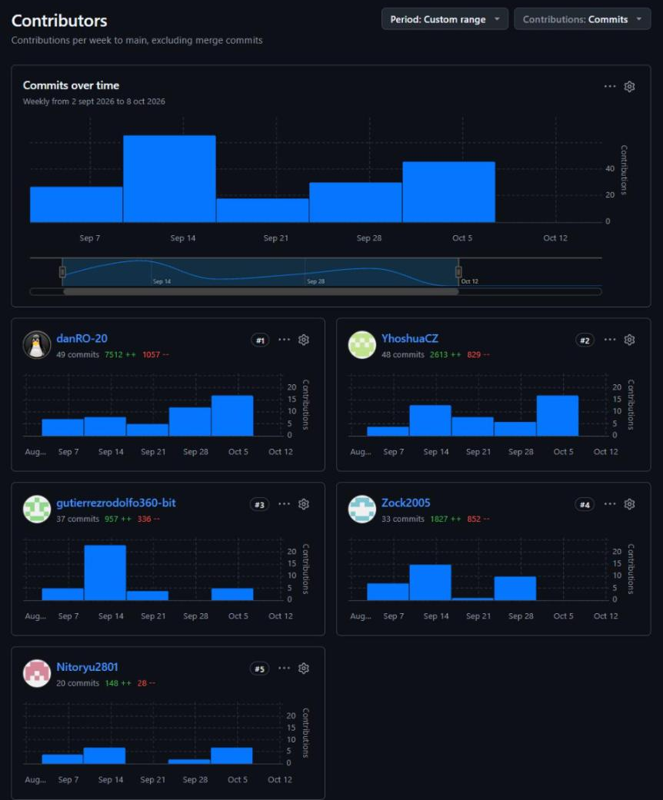

## Project Report Collaboration Insights

**Link de los repositorios de la organización:**
https://github.com/IngesCompany

**Link del repositorio del Informe:**
https://github.com/IngesCompany/doofplus-report.git

### TB1

Para la entrega TB1 (03/09/2026 al 09/10/2026) el equipo elaboró los capítulos I a V del informe. Cada capítulo se trabajó en su propia rama (`feature/chapter1` a `feature/chapter5`) y el registro de versiones en `feature/README`; las ramas se integraron en `develop` y la versión de la entrega se publicó en `main` mediante `release/v2.6.0` y `hotfix/v2.6.1`, siguiendo GitFlow. Los cinco integrantes participaron con commits en el repositorio durante todo el periodo.

### TB2

Después de TB1 (desde el 10/10/2026) el equipo corrigió y mejoró los artefactos presentados, de acuerdo con el Registro de Versiones (desde la versión 2.6.2): revisó los Capítulos I a V, actualizó los diagramas C4 y las capturas del Event Storming, alineó las User Stories con el Product Backlog, renombró la Landing Page a Website y agregó las referencias que faltaban en la Bibliografía. El 31/10/2026 se incorporó al equipo Torres Juárez, Alisee Muriel, que agregó su perfil al Capítulo I.

El trabajo siguió GitFlow: cada capítulo en su rama `feature/chapter1` a `feature/chapter5`, la exportación a PDF en `feature/pandoc-export` y cada mejora puntual en su propia rama `feature/`; las ramas se integraron en `develop` y la versión 2.7.0 se publicó en `main` mediante `release/v2.7.0`. Desde esa versión el informe sigue la estructura de la guía Docs-as-Code del curso: el `README.md` es el archivo principal con el índice enlazado y las secciones están en archivos numerados dentro de `report/` (front matter `01-09`, capítulos `10-89`, bibliografía `99` y anexos).

---
